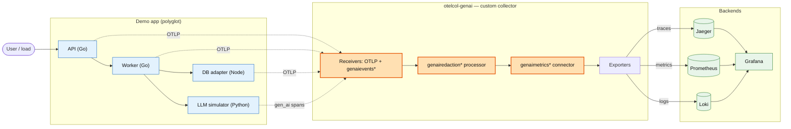
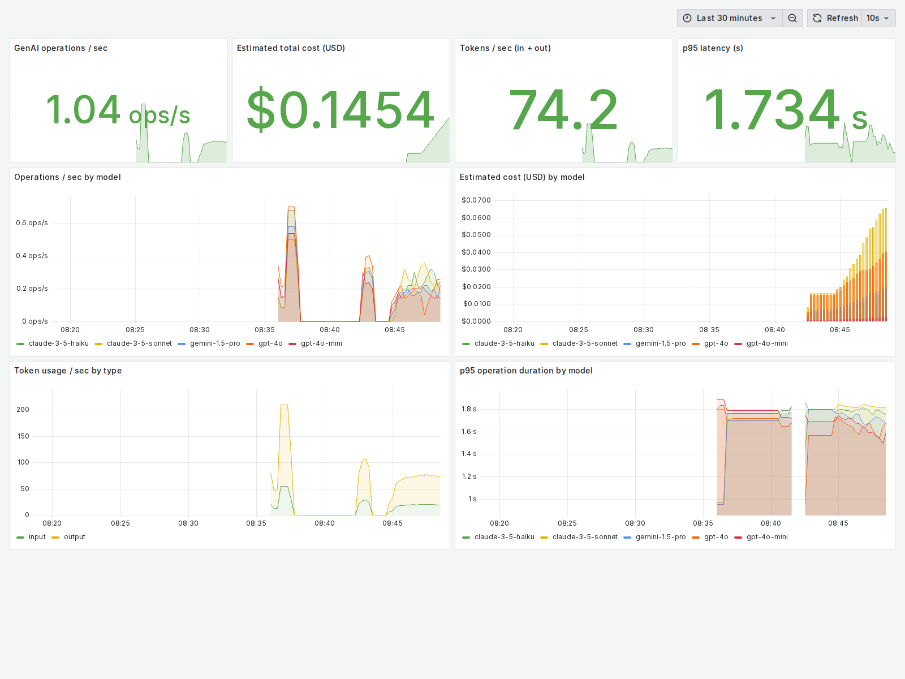
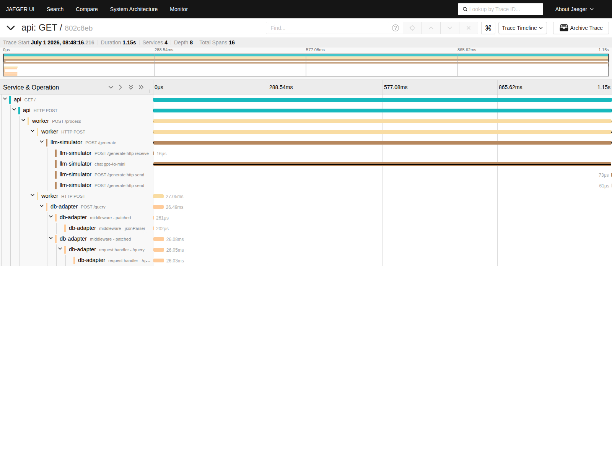
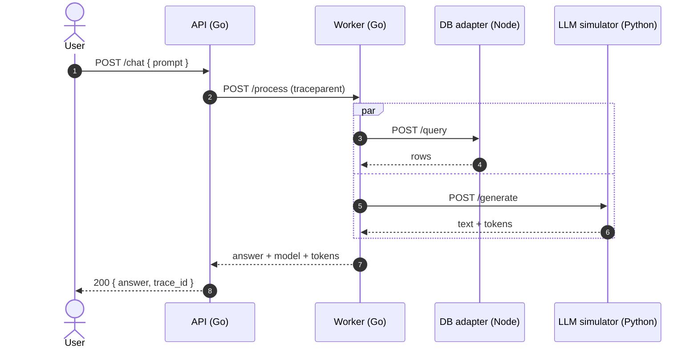

# otel-collector-ai-lab

> A custom **OpenTelemetry Collector distribution** in Go that receives traces, metrics, and logs from a small **polyglot** distributed system, and **sanitizes & enriches GenAI (`gen_ai.*`) telemetry** before shipping it to Jaeger, Prometheus, Loki, and Grafana. Runs locally with one command on Docker Compose or Kubernetes (kind).


---

## What is this?

Modern apps increasingly call Large Language Models (LLMs). Those calls are great telemetry — you want to know **how many tokens** you burned, **what they cost**, and **how slow** they were — but they are also dangerous: the spans carry **raw prompts and responses**, which routinely contain personal data (emails, card numbers, secrets).

**`otel-collector-ai-lab` is a governance-and-insight layer for GenAI telemetry.** It is a purpose-built OpenTelemetry Collector that:

1. 🛡️ **Redacts** prompt/response content and scrubs PII *before* it ever reaches a backend.
2. 📊 **Derives metrics** (tokens, cost, latency) from GenAI spans so you get dashboards for free.
3. 🔌 **Ingests** a simple bespoke GenAI-event format over HTTP and turns it into proper OpenTelemetry signals.

It is built with the official **OpenTelemetry Collector Builder (`ocb`)** and ships **three custom Go components** written from scratch.



<sub>🟧 Orange boxes are the custom Go components built for this project. Rendered diagrams live in [`docs/diagrams/rendered/`](docs/diagrams/rendered).</sub>

---

## Highlights

| Area | What's included |
| --- | --- |
| **Go** | Three hand-written Collector components (processor, connector, receiver) + two Go microservices, clean module boundaries, ~90% unit-test coverage with the race detector |
| **OpenTelemetry Collector internals** | Custom distribution built with `ocb`; factories, `pdata` manipulation, connector aggregation, a `confighttp` receiver, golden tests |
| **Full telemetry pipelines** | Traces, metrics **and** logs — OTLP in, exported to Jaeger / Prometheus / Loki, visualized in Grafana |
| **Distributed systems** | Polyglot services (Go, Node, Python) with **cross-language W3C context propagation** — one request → one trace across four services |
| **AI / GenAI** | Follows the OpenTelemetry **GenAI semantic conventions**; redacts prompts/responses, scrubs PII, and derives token/cost/latency metrics |
| **Cloud-native** | Docker Compose stack + Kubernetes via **kind**, **Kustomize** overlays, and a **Helm** chart |
| **Production polish** | Makefile, multi-language CI, ADRs, troubleshooting guide, load test, rendered diagrams, screenshots |

---

## The custom components

All three live in [`components/`](components) as one Go module and are packaged into the `otelcol-genai` binary via [`collector/builder-config.yaml`](collector/builder-config.yaml).

### 🛡️ `genairedaction` — processor
Sanitizes and enriches `gen_ai.*` telemetry on traces **and** logs:
- **Redacts** prompt/response content (`gen_ai.input.messages`, `gen_ai.output.messages`, `gen_ai.system_instructions`, tool call args/results) — `mask`, salted `hash`, or `delete`.
- **Scrubs PII** (emails, card-like numbers, SSNs, API keys) from every remaining string value.
- **Normalizes** the deprecated `gen_ai.system` → `gen_ai.provider.name`.
- **Enriches** with an estimated `gen_ai.usage.cost_usd` (from token counts × a price table) and `deployment.environment`.

### 📊 `genaimetrics` — connector (traces → metrics)
Consumes trace spans and emits cumulative, semconv-aligned metrics, keyed by provider × model × operation:
`gen_ai.client.operation.count`, `gen_ai.client.operation.duration` (histogram), `gen_ai.client.token.usage` (histogram, split by `input`/`output`), and `gen_ai.client.cost.usd`.

### 🔌 `genaievents` — receiver
Accepts a simplified GenAI-event JSON payload over HTTP and converts each event into a proper `gen_ai` **CLIENT** span — a bespoke ingestion endpoint for systems that can't emit OTLP directly.

```bash
curl -XPOST localhost:8099/v1/genai-events \
  -d '{"provider":"openai","model":"gpt-4o-mini","operation":"chat",
       "input":"my email is alice@example.com","output":"done",
       "input_tokens":1500,"output_tokens":300,"duration_ms":820}'
```

---

## Redaction in action

A prompt like `"My SSN is 123-45-6789 and email alice@example.com"` enters as `gen_ai.input.messages`. What reaches the backend:

```
gen_ai.input.messages : [REDACTED]        # sensitive content masked
gen_ai.output.messages: [REDACTED]
gen_ai.provider.name  : openai            # normalized from gen_ai.system
gen_ai.usage.cost_usd : 0.000405          # derived enrichment
```

…and the connector simultaneously produces `gen_ai_client_token_usage_sum`, `gen_ai_client_cost_usd_total`, and `gen_ai_client_operation_duration_seconds_bucket` metrics. No raw prompt ever lands in Jaeger, Loki, or Prometheus.

---

## Quickstart

**Prerequisites:** Docker + Docker Compose. (For local builds/tests: Go 1.25+, and Node/Python if you work on those services.)

```bash
make up                 # build images + start collector, backends, and services
make load               # start a small load generator (optional)
```

Then open:

| UI | URL |
| --- | --- |
| Grafana (GenAI dashboard, anonymous admin) | http://localhost:3000 |
| Jaeger (distributed traces) | http://localhost:16686 |
| Prometheus | http://localhost:9090 |
| API service | http://localhost:8080 |

Drive traffic yourself and inspect the redaction:

```bash
curl -s localhost:8080/ | jq          # triggers a full cross-service request
# In Jaeger, open a trace for service "api" — it spans api → worker → db-adapter + llm-simulator.
# In the llm-simulator span, gen_ai.input.messages is [REDACTED].
```

Stop everything when you're done:

```bash
make down               # stop the stack and clean up
```

> **Note on resources:** the stack is tuned to run on a laptop with per-service memory limits (~1.7 GiB of limits, far less in practice). The in-cluster load generator is behind an opt-in Compose profile (`make load`). Grafana runs with anonymous admin for a friction-free local demo — keep port 3000 bound to localhost.

---

## Screenshots

| Grafana — GenAI overview | Jaeger — cross-language trace |
| --- | --- |
|  |  |

---

## Architecture

See [`docs/architecture.md`](docs/architecture.md) for the full write-up. Diagrams (rendered SVG/PNG in [`docs/diagrams/rendered/`](docs/diagrams/rendered)):

**Request flow** — one request, one trace across four services:



---

## Kubernetes

The same stack runs on Kubernetes (kind), packaged two ways:

```bash
# Kustomize (base + dev/prod overlays)
kubectl apply -k deploy/k8s/overlays/dev

# …or the Helm chart for the collector
helm install otel-genai deploy/k8s/charts/otel-genai-collector

# Validate manifests without a cluster:
make k8s-validate       # kustomize build | kubeconform + helm lint/template
```

An opt-in smoke test spins up a kind cluster, loads the locally-built images, and asserts the collector is healthy: `make kind-up` / `make kind-down` (build the images first with `make up`, and run with Compose stopped).

---

## Repository layout

```
components/            # 3 custom Go collector components (processor, connector, receiver) + tests
collector/            # ocb manifest + pipeline configs + Dockerfile
services/             # api, worker (Go) · db-adapter (Node/TS) · llm-simulator (Python) · shared (Go)
deploy/compose/       # docker-compose stack + Prometheus/Loki/Grafana provisioning
deploy/k8s/           # Kustomize base + overlays, and a Helm chart
docs/                 # architecture, ADRs, troubleshooting, diagrams, screenshots
load/                 # load generator
scripts/              # diagram rendering, screenshots, kind smoke test
```

---

## Development

```bash
make test             # unit tests (race + coverage on the components module)
make lint             # golangci-lint (or go vet)
make collector        # build the otelcol-genai binary with ocb
make build-go         # compile the Go services
make diagrams         # render Mermaid diagrams to SVG/PNG
```

The build uses the OpenTelemetry Collector Builder pinned to `v0.155.0`; components pin core stable modules to `v1.61.0` and beta/contrib to `v0.155.0`. See [`docs/adr/`](docs/adr) for the key decisions.

---

## Documentation

- [Architecture](docs/architecture.md)
- [Architecture Decision Records](docs/adr)
- [Troubleshooting](docs/troubleshooting.md)

## License

[Apache License 2.0](LICENSE)
