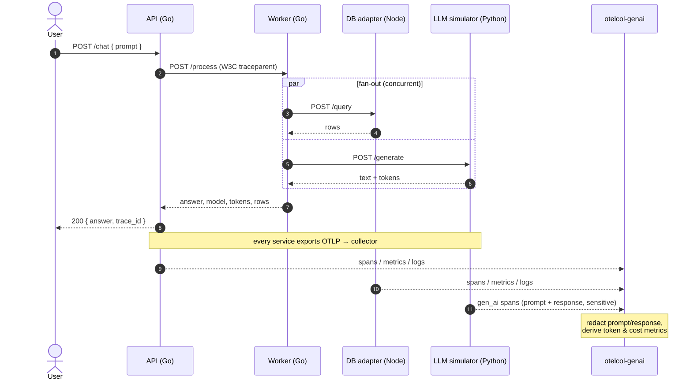

# Architecture

`otel-collector-ai-lab` is a small distributed system plus a custom
OpenTelemetry Collector that governs and enriches its GenAI telemetry.

## Overview

A request enters the **api** service and fans out through **worker** to the
**db-adapter** and **llm-simulator**. Every service is instrumented with
OpenTelemetry and exports OTLP to the custom **otelcol-genai** collector, which
sanitizes and enriches the data before exporting to Jaeger, Prometheus, and Loki
for visualization in Grafana.

## Services

| Service | Language | Role |
| --- | --- | --- |
| `api` | Go | HTTP entry point; forwards chat requests to the worker |
| `worker` | Go | Fans out concurrently to db-adapter and llm-simulator |
| `db-adapter` | Node.js / TypeScript | Simulates a datastore lookup |
| `llm-simulator` | Python | Simulates an LLM call and emits `gen_ai.*` spans |
| `shared` | Go | Common OTel bootstrap + instrumented HTTP helpers for the Go services |

### Cross-language trace propagation

All three SDKs default to the **W3C `tracecontext`** propagator, and every
outbound HTTP call uses an instrumented client (`otelhttp.NewTransport` in Go,
auto-instrumentations in Node, `opentelemetry-instrument` in Python). The result
is a single trace spanning all four services:

## The collector

Built from source with `ocb` (see [`collector/builder-config.yaml`](../collector/builder-config.yaml)),
`otelcol-genai` runs three pipelines:

- **traces:** `otlp` + `genaievents` → `memory_limiter`, **`genairedaction`**,
  `batch` → Jaeger, **`genaimetrics`** connector, debug
- **metrics:** `otlp` + **`genaimetrics`** → `memory_limiter`, `batch` →
  Prometheus, debug
- **logs:** `otlp` → `memory_limiter`, **`genairedaction`**, `batch` → Loki, debug

### Custom components

- **`genairedaction` (processor)** — redacts prompt/response content, scrubs PII,
  normalizes the provider attribute, and derives `gen_ai.usage.cost_usd`. Operates
  on traces and logs.
- **`genaimetrics` (connector)** — aggregates GenAI spans into cumulative metrics
  (`gen_ai.client.operation.count`, `.operation.duration`, `.token.usage`,
  `.cost.usd`) keyed by provider × model × operation.
- **`genaievents` (receiver)** — an HTTP endpoint that converts a bespoke
  GenAI-event JSON payload into `gen_ai` CLIENT spans.

See [ADR 0001](adr/0001-custom-collector-distribution.md) and
[ADR 0004](adr/0004-genai-redaction-strategy.md) for the rationale.

## Deployment

The same components run under Docker Compose (primary local path) or on
Kubernetes via kind, packaged as Kustomize overlays and a Helm chart. Because of
the ~2 GiB RAM budget, Compose is the path that runs the full stack live; the
Kubernetes manifests are self-contained (no external backends) and are validated
with `kustomize build | kubeconform`, `helm lint`, and `helm template`, plus an
opt-in kind smoke test.
